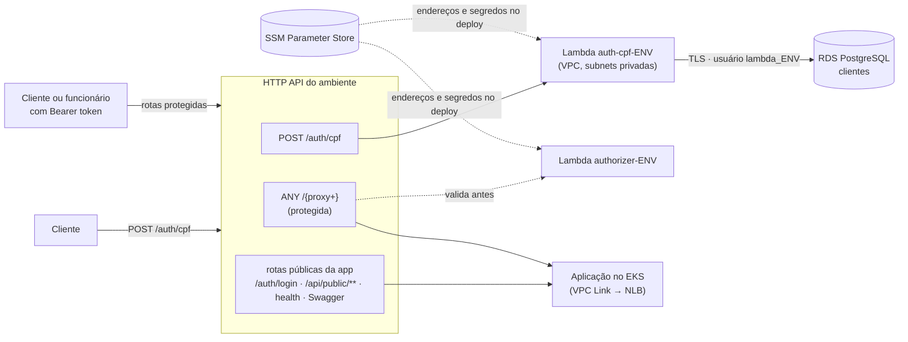

# postech-16soat-lambda

Function Serverless de **autenticação por CPF** do Tech Challenge (FIAP/SOAT, Grupo 15, Fase 3),
o **Lambda Authorizer** que protege as rotas sensíveis no API Gateway e o Terraform das funções e
das rotas de cada ambiente (`homolog` e `prod`).

Faz parte de um conjunto de quatro repositórios:

| Repositório | Papel |
|---|---|
| [postech-16soat-infra-k8s](https://github.com/daniellrsouza/postech-16soat-infra-k8s) | Rede, EKS, ECR, NLB, API Gateway |
| [postech-16soat-infra-db](https://github.com/daniellrsouza/postech-16soat-infra-db) | Banco gerenciado (RDS PostgreSQL) |
| [postech-16soat-lambda](https://github.com/daniellrsouza/postech-16soat-lambda) (este) | Autenticação por CPF (Lambda + authorizer) e rotas do gateway |
| [postech-16soat-app](https://github.com/daniellrsouza/postech-16soat-app) | Aplicação Spring Boot no EKS e documentação de arquitetura (`docs/`) |

Ordem de provisionamento: infra-k8s → infra-db → **lambda** → app. As decisões estão no ADR-004
(JWT HS256 + Lambda Authorizer) e na RFC-003 (estratégia de autenticação), em `docs/` do
repositório da aplicação.

## Arquitetura deste repositório



### `POST /auth/cpf`

```http
POST /auth/cpf
Content-Type: application/json

{ "cpf": "529.982.247-25" }
```

| Situação | Resposta |
|---|---|
| CPF com formato ou dígito verificador inválido, ou corpo inválido | `400 {"message": "CPF inválido"}` |
| Cliente não cadastrado | `404 {"message": "Cliente não encontrado"}` |
| Cliente `INATIVO` ou `BLOQUEADO` | `403 {"message": "Cliente não está ativo"}` |
| Cliente `ATIVO` | `200 {"accessToken": "<JWT>"}` |
| Falha ao consultar o banco | `500 {"message": "Erro ao autenticar"}` (log `ERROR` com `integration: postgres`) |

Aceita 11 dígitos ou a máscara `000.000.000-00`. O token é HS256, com `sub` = id do cliente,
`role` = `CLIENTE`, `iss` = `tech-challenge-auth` e validade de 1 hora; o CPF não vai no token.

### Lambda Authorizer

Resposta simples (payload 2.0) do HTTP API. Valida o header `Authorization: Bearer <token>`:
assinatura HS256 com o segredo do ambiente, expiração e emissor (`tech-challenge-auth` para
clientes, `tech-challenge-backend` para funcionários vindos do `POST /auth/login`). Repassa `sub` e
`role` ao gateway; a autorização por perfil continua na aplicação. Sem token, o gateway responde
401; com token inválido ou expirado, 403.

### Observabilidade

Logs em JSON, uma linha por evento, no CloudWatch (`/aws/lambda/<função>-<env>`), sempre com o
`correlationId` (= `requestId` do API Gateway, o mesmo do access log e do header
`X-Correlation-Id` recebido pela aplicação). O CPF aparece mascarado (`*********25`). Rejeições do
authorizer registram o código do erro (ex.: `ERR_JWT_EXPIRED`, `ERR_JWS_INVALID`).

## Estrutura

```
src/
  auth-cpf/      handler e acesso ao Postgres
  authorizer/    handler do Lambda Authorizer
  shared/        CPF, JWT e logger
test/            Vitest
certs/           bundle de CAs do RDS (TLS verificado)
scripts/
  build.mjs      esbuild: dist/<função>/index.js
  tf.sh          init com o backend da conta + plan/apply/destroy de um ambiente
terraform/       funções, authorizer, integração e rotas do ambiente
.github/workflows/ci-cd.yml
```

## Tecnologias

Node.js 22 · TypeScript · jose (JWT) · pg (PostgreSQL) · esbuild · Vitest · AWS Lambda ·
API Gateway HTTP API (Lambda Authorizer) · Terraform 1.15 · GitHub Actions.

## Execução local

```bash
npm ci
npm run ci          # typecheck + testes com cobertura (mínimo 90% linhas, 85% branches) + build
```

Deploy manual (credenciais do AWS Academy; infra-k8s e infra-db já aplicados):

```bash
npm run build
scripts/tf.sh homolog plan
scripts/tf.sh homolog apply
```

Exemplo contra homolog:

```bash
API=$(aws ssm get-parameter --name /tech-challenge/homolog/apigateway-api-endpoint --query Parameter.Value --output text)
TOKEN=$(curl -s -X POST "$API/auth/cpf" -H 'content-type: application/json' -d '{"cpf":"52998224725"}' | jq -r .accessToken)
curl -s "$API/clientes/<id-do-cliente>/ordens" -H "Authorization: Bearer $TOKEN"
```

## Deploy (CI/CD)

`.github/workflows/ci-cd.yml`:

| Evento | O que roda |
|---|---|
| PR para `develop` ou `main` | typecheck, testes, build, `terraform validate` e `plan` do ambiente de destino |
| push na `develop` | testes, build e `apply` em **homolog** |
| push na `main` | testes, build e `apply` em **prod** |
| `workflow_dispatch` | `plan`/`apply`/`destroy` manual de um ambiente |

A `main` é protegida e só recebe mudanças por Pull Request. Secrets: `AWS_ACCESS_KEY_ID`,
`AWS_SECRET_ACCESS_KEY` e `AWS_SESSION_TOKEN`. O segredo JWT e a senha do banco não são secrets do
GitHub: o Terraform os lê do SSM, onde são gerados pelo infra-db.

## APIs

Swagger da aplicação e coleções Postman: ver
[postech-16soat-app](https://github.com/daniellrsouza/postech-16soat-app). A URL de cada ambiente
está em `/tech-challenge/<env>/apigateway-api-endpoint`.
